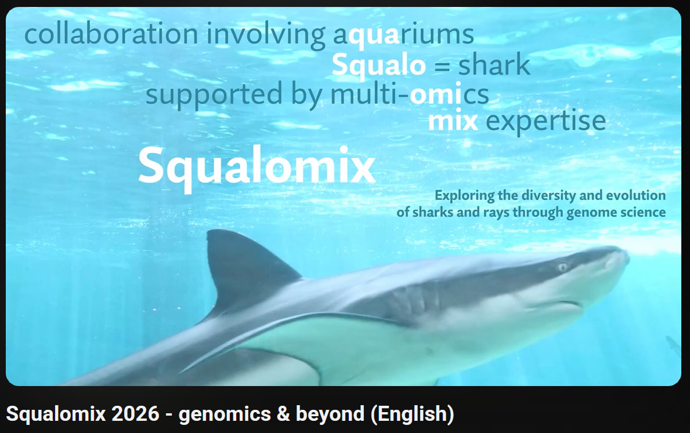

## Latest updates

| Year-Month | Event |
| --- | --- |
| 2026 Sep | Our opsin study presented at [21st Intl Conf Retinal Proteins (ICRP)](https://www.congressi.unisi.it/retinalproteins2026/) held in Siena, Italy |
| 2026 May | Our [PCR-based sexing preprint](https://www.biorxiv.org/content/10.64898/2026.05.02.722412v1) released at bioRxiv |
| 2026 May | Our activity introduced at [Sharks International 2026](https://si2026.org/) held in Colombo, Sri Lanka |
| 2025 Aug | Our activity introduced at [International Basking Shark Conference](https://www.baskingshark.ie/conference2025) in Galway, Ireland |
| 2025 Aug | Our activity introduced at [Congress of the European Society of Evolutionary Biology (ESEB)](https://eseb2025.com/) in Barcelona, Spain |

Full chronology: [History](history.md).

## What is 'Squalomix'?

Cartilaginous fishes (sharks, rays, chimaeras) charted an evolutionary trajectory distinct from other lineages. ​Not simply generalized as "fish," these species require dedicated research frameworks to decode their lives. Since 2020, Squalomix has met this need sustainably. Partnering with public aquariums, marine stations, and allied consortia, we study diverse species—from migratory pelagic sharks to our core focus, Japanese coastal biodiversity. Crucially, this collaborative hub incubates the early-career researchers cycling through our operations.

​We integrate genome data with rigorous laboratory solutions. To navigate the highly variable genome organization across cartilaginous fishes, we anchor our sequencing output in empirical cellular-level analysis, enabling karyotyping and nuclear DNA content measurement. This biology-first foundation yields profound insights, including unveiling the evolutionary organization of their sex chromosomes, now recognized as the oldest among vertebrates.

​Furthermore, we move beyond sequencing and computation. Informatically derived evolutionary hypotheses are reconstructively verified via experiments. Our in vitro systems embody this approach, enabling the exploration of unique adaptations, as demonstrated in our research on whale shark deep-sea vision.

​Our scope spans from contributing to genetic monitoring of wild populations to deeply decoding their unique lifestyles. By deciphering the genomic grammar that translates the information encoded in DNA into higher-order biological phenomena—such as an organism's pace of life—we seek to elucidate the fundamental principles driving the vertebrate tree of life.

Please find more details in [our position paper](https://doi.org/10.12688/f1000research.123591.1).

For updates, follow us on [Bluesky](https://bsky.app/profile/kurakulabmsm.bsky.social) and [X](https://x.com/Squalomix4earth).

## Why sharks (and rays)?

The taxon Elasmobranchii (sharks and rays) is one of the most long-established evolutionary lineages of vertebrates severely underrepresented in molecular-level research. This limitation is attributable to the long-standing scarcity of their whole genome sequence information, due to the elusive nature and low fecundity of these animals, as well as their large, repetitive genomes. Their peculiar body fluid composition has also hindered routine cell culturing that is required for chromosome analysis which serves as an indispensable reference for validating genome sequence assembly.

More about the consortium: [About](about.md). Our outputs are collected under [Data & Tools](data.md), the species we work on under [Species](species.md), and our papers under [Publications](publications.md).

Citation: [Nishimura et al. 'Squalomix: shark and ray genome analysis consortium and its data sharing platform' F1000Res, 2022](https://f1000research.com/articles/11-1077).

*Last updated: November 5, 2026*
